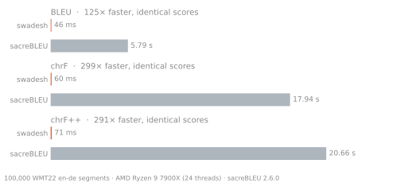

# swadesh

**sacreBLEU, bit for bit, in Rust.** BLEU, chrF, chrF++ and TER with the same scores, the same signatures
and the same CLI, and much faster: 22–45× on one core and 125–318× on a 24-thread desktop for BLEU, chrF and TER.

<p align="center"></p>

```bash
pip install swadesh
```

```python
import swadesh as sacrebleu   # that's the whole migration

bleu = sacrebleu.corpus_bleu(hyps, [refs])
print(bleu)            # the same BLEUScore object, value and string sacreBLEU gives you
```

Or keep your code and every library that imports sacreBLEU (Hugging Face `evaluate`,
fairseq, Marian/OpenNMT scripts…) unchanged:

```python
import swadesh
swadesh.patch()        # sacrebleu.* now runs on swadesh
```

```bash
swadesh ref.txt -i hyp.txt -m bleu chrf      # the sacreBLEU CLI, same flags, same output
```

## Identical, not "close"

swadesh is a differential re-implementation of [sacreBLEU](https://github.com/mjpost/sacrebleu) 2.6.0.
Every statistic, score, signature string and printed line is compared with `==` against
sacreBLEU, never with a tolerance:

- Property-based fuzzing (hypothesis) over an adversarial alphabet: Unicode whitespace,
  CJK, combining marks, `&amp;`/`<skipped>`/`-\n`, Turkish `İ`, final sigma, astral characters.
- Real WMT22 test sets across 7 language pairs and all native tokenizers.
- Python 3.10–3.14 × numpy 1.26 / 2.x, on x86-64 Linux, ARM64 Linux and Apple M4.
- 290 byte-for-byte comparisons of the standalone CLI against the `sacrebleu` CLI.

Don't take our word for it. Check it on your own data:

```bash
python -m swadesh.verify -r ref.txt -i hyp.txt
# BLEU    corpus identical  sentences 3000/3000 identical  (29x faster corpus scoring)
# chrF    corpus identical  sentences 3000/3000 identical  (46x faster corpus scoring)
# chrF++  corpus identical  sentences 3000/3000 identical  (35x faster corpus scoring)
# ALL IDENTICAL
```

Bit-exact means reproducing sacreBLEU's quirks too. Some of them:

* The `zh` tokenizer's range table contains `u'\u20000'`, which in Python is the
  two-character string `'\u2000' + '0'`. String comparison therefore treats
  U+2001–U+2A6D (general punctuation, arrows, math symbols…) as "Chinese characters". swadesh does too.
* The `intl` tokenizer's `\p{P}`/`\p{S}`/`\p{N}` classes come from tables generated from
  the `regex` module itself, and Python's `str.split()` whitespace set is reproduced exactly.
* CPython 3.12 changed `sum()` of floats to compensated summation, and 3.14 changed it again.
  BLEU's geometric mean goes through `sum()`, so sacreBLEU's own scores differ in the last
  bits between Python versions ([details](docs/python-version-drift.md)). swadesh detects the
  interpreter and matches it.
* Bootstrap resampling uses numpy's PCG64 stream and float32 accumulation. swadesh draws
  the same indices and reproduces numpy's float32 summation order, so confidence intervals
  and paired-test p-values are identical too.

How this works is described in [docs/how-its-exact.md](docs/how-its-exact.md).

## Benchmarks

Hypotheses are perturbed WMT22 en-de references (word drops, swaps and reversals, fixed seed).
Every swadesh result below was checked `==` against sacreBLEU 2.6.0 on the same machine.
Times are best of 3 (BLEU/chrF corpus) or a single run (TER, sentence-level, bootstrap).
Source: [`bench/results/SUMMARY.md`](bench/results/SUMMARY.md) · reproduce with `bench/get_data.sh && python bench/bench.py`.

**AMD Ryzen 9 7900X, idle machine** (`bench/results/final-troy1-*.json`)

| | sacreBLEU | swadesh, 24 threads | speedup | swadesh, 1 core | speedup |
|---|---:|---:|---:|---:|---:|
| corpus BLEU (100k) | 5.79 s | 0.046 s | **125×** | | 25.7× (20k) |
| corpus chrF (100k) | 17.94 s | 0.060 s | **299×** | | 44.9× (20k) |
| corpus chrF++ (100k) | 20.66 s | 0.071 s | **291×** | | 36.0× (20k) |
| corpus TER (10k) | 6.34 s | 0.038 s | **165×** | 0.165 s | 38.8× |
| sentence BLEU ×20k | 0.97 s | 0.0072 s | **134×** | 0.044 s | 22.5× |
| sentence chrF ×20k | 2.71 s | 0.0085 s | **318×** | 0.073 s | 37.3× |
| BLEU + 1000 bootstrap resamples (5k) | 0.48 s | 0.015 s | **31×** | 0.036 s | 13.3× |

Earlier builds were also benchmarked on an ARM Cortex-X925 (GX10, up to 379× on chrF) and an
Apple M4 (up to 242×); see [`bench/results/SUMMARY.md`](bench/results/SUMMARY.md).

The corpus repeats the 2,037 WMT22 references, which helps sacreBLEU's tokenizer
`lru_cache`, so these numbers understate the speedup on non-repetitive data.

## Beyond sacreBLEU

Things sacreBLEU doesn't have, all bit-identical to doing the same thing with sacreBLEU in a loop:

```python
import swadesh
from swadesh import BLEU, CHRF, mbr

# Every sentence score at once, in parallel (e.g. data filtering, analysis)
scores = CHRF().sentence_scores(hyps, [refs])                  # == [sentence_score(h, [r]).score ...]

# n x m score matrices for MBR decoding / best-of-n reranking (128x128 chrF: 4.9 s -> 31 ms)
M = CHRF().pairwise(candidates)                                 # candidates vs candidates
best, utility = mbr(candidates)                                 # minimum Bayes risk pick

# Reward functions for RL fine-tuning (TRL GRPO-compatible signature)
from swadesh.rewards import chrf_reward, bleu_reward
reward = chrf_reward(ref_column="reference")                    # completions=[...], reference=[...] -> [0..1]

# Native bootstrap CIs and paired significance tests (identical p-values)
BLEU().corpus_score(hyps, [refs], n_bootstrap=1000)
swadesh.PairedTest([("base", base), ("new", new)], {"BLEU": BLEU(references=[refs])}, None, test_type="bs")()
```

- **Exact tokenizers.** `swadesh.tokenize(lines, "13a")` returns sacreBLEU's tokenization, in parallel.
- **In the browser.** The CLI compiles to a 320 KB WebAssembly module; `docs/playground/` is a
  static page that runs it, with output byte-identical to the `sacrebleu` CLI.
- **Standalone binary.** `crates/swadesh-cli` is a 650 KB executable with no Python,
  for CI pipelines and agents. Its output is byte-identical to the sacreBLEU CLI for BLEU, chrF and TER.
- **Rust crate.** `swadesh-core` gives tokenizers, statistics and score arithmetic for Rust programs.

## Coverage

| | status |
|---|---|
| BLEU: tokenizers `13a`, `intl`, `zh`, `char`, `none` | native |
| BLEU: `ja-mecab`, `ko-mecab`, `spm`, `flores101/200`, `spBLEU-1K` | tokenized by sacreBLEU in Python, then matched natively |
| chrF, chrF++ (all options) | native |
| bootstrap CIs, paired bootstrap, paired approximate randomization | native kernels, sacreBLEU's statistics |
| TER (all options: normalized, no-punct, asian support, case-sensitive) | native (tercom shifts + beam edit distance) |
| `-t` test-set downloads, all other CLI features | sacreBLEU (the `swadesh` Python CLI *is* the sacreBLEU CLI, accelerated) |

## Why "swadesh"?

In the 1950s the linguist and anthropologist Morris Swadesh compiled lists of core vocabulary
and compared languages by counting how many of those words they share. That technique,
lexicostatistics, measures similarity by shared units. BLEU and chrF do the same for a
translation and its reference: they count shared n-grams.

## Credits

swadesh subclasses and depends on [sacreBLEU](https://github.com/mjpost/sacrebleu) by Matt Post
and contributors (Apache-2.0). Its tokenizers are ports of sacreBLEU's. chrF is due to
Maja Popović; BLEU to Papineni et al. (2002). Please keep citing sacreBLEU
([Post, 2018](https://aclanthology.org/W18-6319/)) when you report scores: they *are* sacreBLEU scores.

License: Apache-2.0.
