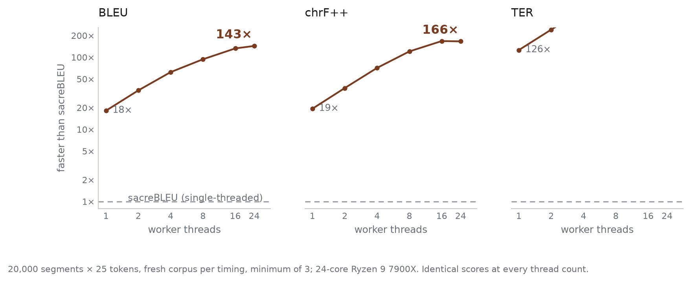
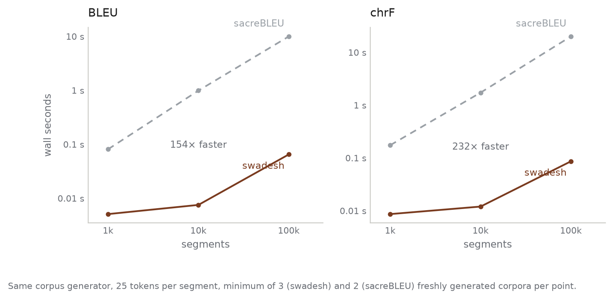

# A faster scorer I couldn't trust, until it stopped being a different scorer

*swadesh is a drop-in replacement for sacreBLEU, written in Rust. It returns exactly the same numbers
— every float compares `==`, the signatures and the CLI output are byte-identical — and it is much
faster. This post is about the Naxi translation model I am training, the measurement standard around
it, and why "faster scorer" only counts if it is also the same scorer.*

Code: [github.com/apeters247/swadesh](https://github.com/apeters247/swadesh) — public, AGPL-3.0 for
everyone, free for commercial use below USD 5M revenue.

---

**tl;dr**

- sacreBLEU's numbers are what the field trusts. A faster implementation is useful only if it returns
  the *same* numbers: **not close, not within 1e-9, but bit-identical**. A scorer that differs in the
  last float bit is not a 100× speedup, it is a new metric.
- On real model output — `qwen3.8-27b` and `llama3.3:70b`, 150 English→German segments each, 12
  configurations apiece — swadesh and sacreBLEU agree exactly: **24/24 corpus scores identical and 0
  of 300 sentence scores differing**, and the same on five more cached model outputs. Ten more
  language pairs are byte-identical too.
- The design decision that makes that possible: move the **integer** half of the computation
  (tokenization, n-gram counting, the TER shift search) to Rust, and **port** sacreBLEU's own
  **floating-point** arithmetic rather than rewriting it. If the integers match, the score matches
  *by construction*.
- On a synthetic 20,000-segment stress corpus (25-token segments) with 24 worker threads: **143×
  faster for BLEU, 166× for chrF++ and 1143× for TER**, with identical scores at every
  thread count. On WMT22-derived data, where the numbers are less extreme, the same comparison gives
  117–316×. Single-threaded, the synthetic corpus is still 18× (BLEU) to 126× (TER).
- It now has things sacreBLEU does not: per-segment TER explanations, a streaming accumulator, a
  paired difference with a power estimate, thread control, a `pytest` plugin and a HuggingFace
  `evaluate` module.
- Why I am telling you: **if the numbers are bit-identical, swapping the implementation cannot make
  anybody's published benchmark incomparable, and it can only make them wait less.**

---

## The project this came out of

I am training a Naxi ↔ Chinese/English translation model for [naxiai.com](https://naxiai.com). Naxi is
written in Dongba glyphs and in a syllabic romanisation. The model I serve (`nxkd1-k-q5`, a 4.8B
Q5_K_M GGUF, fine-tuned on ~1.15 TB of data on the GPU box in my rack) scores **chrF++ 45.78 /
NTQS 69.07** on a leak-free 446-row promotion gate
([Apeters247/naxi-mt-benchmark](https://huggingface.co/Apeters247/naxi-mt-benchmark)).

The gate is where the measurement rules come from:

- **Two metrics, always both, on the same rows.** chrF++ (sacreBLEU, `word_order=2`) says whether the
  right *sentence* was translated; NTQS — my own scorer, tone /30, semantic /35, dialect /20,
  completeness /15 — says whether the output is well-formed Naxi at all. They fail in different ways
  on purpose. One without the other is not a number I can quote.
- **Significance by paired bootstrap, clustered by reference, 3000 resamples.** An unclustered
  interval is roughly half as wide and overstates confidence. Everything is reported as an interval,
  not a point score.
- **The noise band is ~1.4 chrF++** across candidate ranks 4–22. A "0.4 improvement" is not news. If
  I cannot state a gap with an interval, I do not state it.
- **Exactness, because the ledger has to stay comparable.** Every number in it — earlier arms,
  published baselines, past decisions — came out of sacreBLEU 2.6.0. A scorer that agrees to seven
  significant digits is not the same instrument.

So the loop was: change a checkpoint → score every candidate on chrF++ and NTQS → run the paired test
→ read the interval → usually find the move is inside the band. The scoring step, in Python, was
quietly eating my afternoon. That is the entire motivation.

## What "the same number" has to mean

This is the part that decides everything else, so let me be precise. Writing
\\( f_{\text{s}} \\) for swadesh's corpus score and \\( f_{\text{o}} \\) for sacreBLEU's, the property
I need is

\\[ \forall x:\quad f_{\text{swadesh}}(x) \;=\; f_{\text{sacreBLEU}}(x) \qquad\text{(the same IEEE-754 double)} \\]

where the equality is of the IEEE-754 double that comes out, exactly — not approximate equality. "Within a tolerance" is not a weaker version of this property; it is a
different, much weaker claim, and it does not do what I need. Two reasons:

1. **Comparability is transitive and history is long.** If my scorer can differ in the last bit, then
   every past number is comparable only up to that difference, and every future comparison inherits
   it. I would have to re-score the entire ledger to keep one instrument.
2. **Rounding at a boundary.** Corpus scores get rounded for publication, compared for equality in CI,
   and used as thresholds ("promote if chrF++ > 45.8"). At 15 digits, a 1-ulp difference is invisible
   — until a value sits exactly on a rounding boundary, which is precisely when anyone cares.

There is also a *measured* reason, and it is the interesting one: **sacreBLEU's own scores are not
reproducible across CPython versions**, because BLEU's geometric mean runs through the builtin
`sum()`, whose float algorithm changed in 3.12 (Neumaier compensation) and again in 3.14. On 13,455
perturbed WMT22 segments, 2,132 sentence-level BLEU scores (15.8%) differ between 3.11 and 3.12, by
at most 9 ulps:

| interpreters | sentence BLEU scores differing | max ulps | corpus scores differing |
|---|---|---|---|
| 3.10 → 3.11 | 0 / 13,455 | 0 | 0 / 7 |
| **3.11 → 3.12** | **2,132 / 13,455 (15.8%)** | **9** | **2 / 7** |
| 3.12 → 3.13 | 0 / 13,455 | 0 | 0 / 7 |
| 3.13 → 3.14 | 0 / 13,455 | 0 | 0 / 7 |
| 3.10 → 3.14 | 2,132 / 13,455 (15.8%) | 9 | 2 / 7 |

*Figure 3 (below) shows the same thing as a small multiple.* So "the number" is already a function of
the interpreter. swadesh detects which CPython it is running on and matches that interpreter's
arithmetic — which is the only way "identical" can mean anything operationally.

## How BLEU, chrF and TER are actually computed

The reason exactness is achievable at all is that all three metrics have the same shape: a large
**integer** computation per segment, and a small **floating-point** computation per corpus.

**BLEU** is a clipped n-gram precision with a brevity penalty:

\\[ \mathrm{BLEU} = \mathrm{BP}\cdot\exp\left(\sum_{n=1}^{N} w_n \log p_n\right), \qquad
\mathrm{BP} = \min\left(1,\; e^{1 - r/c}\right) \\]

with \\( p_n \\) the clipped \\( n \\)-gram precision over the corpus
\\( p_n = \dfrac{\sum_{g} \min\big(c_g^{(h)}, \max_j c_g^{(r_j)}\big)}{\sum_g c_g^{(h)}} \\),
\\( c \\) the hypothesis length, \\( r \\) the reference length, and \\( w_n = 1/N \\).

**chrF** is a character n-gram F-score:

\\[ \mathrm{chrF}_\beta = (1+\beta^2)\frac{\mathrm{CHRP}\cdot\mathrm{CHRR}}
{\beta^2\mathrm{CHRP} + \mathrm{CHRR}} \\]

with character precision/recall \\( \mathrm{CHRP}, \mathrm{CHRR} \\) computed exactly like \\( p_n \\)
but over character n-grams. chrF++ appends word 1- and 2-grams to the same counts.

**TER** is a normalized edit rate with block moves:

\\[ \mathrm{TER} = \frac{S + E}{\bar{L}} \\]

where \\( S \\) is the number of accepted phrasal shifts, \\( E \\) is the Levenshtein edit distance
after those shifts, and \\( \bar{L} \\) is the average reference length. The distance is the usual
dynamic program \\( D(i,j) = \min\lbrace D(i-1,j)+1,\; D(i,j-1)+1,\; D(i-1,j-1) + [u_i \neq v_j]\rbrace \\), and each candidate shift is accepted only when it strictly reduces it,
\\( \Delta = D(h,r) - D(\mathrm{shift}(h),r) > 0 \\), under TERCOM's own search limits (blocks of at
most 10 words, moves of at most 50 positions, 1000 candidates per segment).

Now look at what is integer and what is float in those formulas:

| quantity | type | size |
|---|---|---|
| tokenization, n-gram extraction, clipped match counts | exact integers | the whole cost |
| \\( c, r \\) (lengths) | exact integers | one pair |
| \\( p_n \\), \\( \mathrm{BP} \\), the \\( \exp \\) and \\( \log \\) | IEEE doubles | a handful per corpus |
| \\( S, E \\) (shifts, edit distance) | exact integers | the whole TER cost |
| \\( \bar{L} \\), the ratio, the 100× | IEEE doubles | one per corpus |

Every count is an integer, so it is exact by construction. Only the last handful of operations are
floating point, and those are cheap. That asymmetry is the whole opportunity: **spend the rewrite
where the integers are, and keep the floating point exactly where sacreBLEU put it.**

## The design: rewrite the integer half, port the float half

The most important decision was **what not to write**. Reimplementing `exp`, `log` and the
precision/recall ratios is exactly where a last-bit difference would come from, so those operations
are sacreBLEU's own arithmetic: swadesh's metric layer is a **direct port** of sacreBLEU's Python —
`Score`, `Metric`, `Signature` and the score-from-statistics methods — kept line-for-line identical,
down to the log channel name, the exception wording and the signature strings. sacreBLEU is
Apache-2.0, so the port is licence-compatible; `NOTICE` and `docs/licensing.md` record exactly what
came from where.

What Rust *replaces* is the integer half: tokenizing, n-gram extraction and matching, and the TER
shift search. Those are per-segment, they cost essentially all the time, and they are exact by
construction because they are counts.

So the corpus score is not approximated — it is computed by sacreBLEU's arithmetic (the same
operations, in the same order) from counts that Rust produced. If the counts are right, the double is
right, and there is no floating-point code of mine in the path to get wrong.

*(Earlier in the project's life the metric classes literally subclassed `sacrebleu.BLEU` and
overrode one method. They were ported later so that the library needs no sacreBLEU installed at all;
`import swadesh` now runs with sacreBLEU absent, and the classes no longer inherit from it.)*

Two subtleties make this work in practice:

- **Reference caching.** The counts must be the counts for the *same* references in the *same* order,
  including the `None` entries sacreBLEU skips. This is where a whole class of bugs lives (see
  `num_refs` below).
- **The paths that genuinely compute floats natively** — batch sentence scores, MBR pairwise
  matrices, bootstrap resampling — are ports too, and are tested for `==` against sacreBLEU's own
  results rather than assumed correct. Bootstrap resampling, for instance, draws the same indices
  from numpy's PCG64 stream and reproduces numpy's float32 summation order:
  \\( \widehat\theta_b = g\left(\sum_{i \in I_b} s_i\right) \\) in float32, with \\( I_b \\)
  the \\( b \\)-th resample's indices.

## Does it agree on real model output?

Only real output answers this. On a workstation with an RTX PRO 6000 I generated translations with
small models served by Ollama, then scored the same hypotheses with sacreBLEU 2.6.0 and swadesh,
comparing every corpus score *and every sentence score* exactly. Data: WMT24 English→German news,
temperature 0, greedy decode.

| model | segments | BLEU | chrF | chrF++ | TER | corpus `==` | sentence diffs |
|---|---|---|---|---|---|---|---|
| `qwen2.5vl:7b` | 600 | 22.256488 | 52.564888 | 49.482473 | 68.130071 | all | **0 / 600** |
| `granite4:small-h` | 150 | 25.871423 | 58.480785 | 54.969857 | 62.555391 | all | **0 / 150** |
| `devstral:24b` | 150 | 26.958969 | 59.130336 | 55.705941 | 61.275234 | all | **0 / 150** |
| `qwen3.8-abliterated` | 150 | 26.407621 | 59.285038 | 55.861321 | 62.161497 | all | **0 / 150** |
| `nxkd1-k-q5` (English→Naxi, vs. the English source) | 250 | 0.101294 | 11.884049 | 9.851019 | 111.973392 | all | **0 / 250** |

Across BLEU (default / `intl` / floor smoothing), chrF (default / `beta=3`), chrF++ and TER (default /
normalized), that is 24 scored configurations for the three 150-segment models alone: 24 identical
corpus scores, and zero differing sentence scores in every row. The Naxi row matters most to me — it
is my worst-quality output, and if a scorer were going to disagree anywhere, that is where it would.

**One trap worth passing on.** `qwen3.8` is a reasoning model. With a small `num_predict` it returns
an empty `response` and puts everything into `thinking`, so my harness recorded 150 empty hypotheses.
Both scorers then returned a very tidy `0.00`. Identical, and completely meaningless. If you evaluate
a thinking model, assert your hypotheses are non-empty before you believe anything downstream.

## Quirks that had to be reproduced exactly

Exactness is mostly archaeology. The ones that cost real time:

| quirk | what had to be reproduced |
|---|---|
| the `zh` tokenizer's range table | it contains the two-character string `u'\u20000'`, so U+2001–U+2A6D (arrows, math, currency) count as Chinese. The bug is reproduced, and documented as one. |
| `sum()` over floats | its algorithm changed in CPython 3.12 and again in 3.14, so sacreBLEU's own scores move between interpreters. swadesh detects the interpreter and matches its `sum()`. |
| bootstrap arithmetic | the resample sums are float32 numpy. swadesh draws the same PCG64 indices and reproduces numpy's float32 summation order, so intervals and p-values are identical too. |
| `lowercase` and `split` | `lowercase` means Python's `str.lower()` (Unicode-version dependent) and `str.split()` uses Python's whitespace set — which includes `\x1c`–`\x1f` and `\x85` but not U+200B. Tables are generated from the installed Python; case mappings that moved across Unicode versions call back into CPython. |
| `num_refs`, twice | the signature's `num_refs` is the *per-segment* count of non-`None` references, not `len(references)`. Getting that wrong made `corpus_bleu(hypotheses, None)` raise where sacreBLEU returns a score. |

The one I keep coming back to is the last line. **The maths was exact long before the bookkeeping
was.** The same thing happened again a few weeks later, in the streaming accumulator: the point score
was correct while the retained resample rows were silently wrong, because the running total aliased
the first stored row. A point-score test passed. What caught it was comparing the *bootstrapped
confidence interval* against `corpus_score`'s — which is the argument for testing against the
hardest observable, not the easiest one.

## How fast is it, and where does the speed come from

Every number below is from the same machine, the same data, back to back, with the result compared
exactly each time. Two methodology notes, both learned the hard way:

- **A fresh corpus per timing.** sacreBLEU's tokenizers are `lru_cache`d per string, so timing the
  same corpus twice flatters it by up to 2×.
- **Minimum of the repetitions**, with the machine's load average recorded, because nothing else on a
  shared box is ever quiet.

The clearest picture is how the gap widens with threads — swadesh is parallel, sacreBLEU is not:



*Each panel is one metric, 20,000 segments × 25 tokens; the dashed line is sacreBLEU's own
single-threaded time. The scores are identical at every thread count — parallelism partitions the
segments, it does not change the arithmetic.*

| worker threads | BLEU | chrF++ | TER |
|---|---|---|---|
| 1 | 0.10 s | 0.23 s | 3.01 s |
| 2 | 0.05 s | 0.12 s | 1.57 s |
| 4 | 0.03 s | 0.06 s | 0.83 s |
| 8 | 0.02 s | 0.04 s | 0.46 s |
| 16 | 0.01 s | 0.03 s | 0.35 s |
| 24 | 0.01 s | 0.03 s | 0.33 s |
| **sacreBLEU** (single-threaded) | 1.83 s | 4.44 s | 379.33 s |
| **speedup at 24 threads** | **143×** | **166×** | **1143×** |
| swadesh's own 1→24 scaling | 7.9× | 8.6× | 9.1× |
| Amdahl serial fraction | 9% | 8% | 7% |

The parallel speedup of swadesh *against itself* follows Amdahl's law,

\\[ S(n) = \frac{1}{\sigma + (1-\sigma)/n} \quad\Longrightarrow\quad
\sigma = \frac{t_n/t_1 - 1/n}{1 - 1/n} \\]

with a serial fraction \\( \sigma \\) of **9% (BLEU)**, **8% (chrF++)** and
**7% (TER)**. That residual is not scoring: it is loading the corpus and marshalling it
between Python and Rust. It is also why the thread count is a *choice* rather than a fixed maximum —
`swadesh.n_jobs(k)` — and why no thread count changes a number: the per-segment work is independent,
and the final aggregation happens afterwards, in input order.

Corpus size behaves the way you would expect from an implementation that is linear in segments and
allocates one row per segment:



*Log–log, so the slope is the scaling: parallel lines mean both implementations are linear in
segments and the ratio between them is the speedup.*

| segments | BLEU sacreBLEU | BLEU swadesh | × | chrF sacreBLEU | chrF swadesh | × |
|---|---|---|---|---|---|---|
| 1,000 | 0.08 s | 0.01 s | **16×** | 0.17 s | 0.01 s | **20×** |
| 10,000 | 0.99 s | 0.01 s | **131×** | 1.73 s | 0.01 s | **144×** |
| 100,000 | 9.97 s | 0.06 s | **154×** | 20.04 s | 0.09 s | **232×** |

At a million segments it stops being a timing question:

| 1,000,000 segments | sacreBLEU 2.6.0 | swadesh | exact |
|---|---|---|---|
| BLEU | 205 s, **9.0 GB** peak | 2.5 s, **0.97 GB** | identical score, `64.60594655357025` |
| chrF | **`MemoryError`** under a 19.9 GB cap; no score | 1.04 s, 1.06 GB | — |

To be precise about what I measured: I ran sacreBLEU under a 19.9 GB address-space cap and it raised
`MemoryError`; on a machine with considerably more RAM it may well succeed, and I have not tested
that. There is no score on the other side either way, so I am not calling it a speedup.

Now the workloads that actually hurt inside a fine-tuning loop. The first two are exactly what the
Naxi promotion gate does every time: batch the sentence scores, then run a paired test.

| workload | sacreBLEU | swadesh | speedup | exact |
|---|---|---|---|---|
| BLEU `sentence_scores` batch, 20,000 (per-sample reward shape) | 0.126 s | 0.0093 s | **13.5×** | yes |
| chrF `sentence_scores` batch, 20,000 | 0.283 s | 0.0123 s | **23.1×** | yes |
| MBR chrF++, 10 candidates × 10 inputs | 0.346 s | 0.0086 s | **40.4×** | yes |
| BLEU + 1000-resample bootstrap CI, 5,000 segments | 0.195 s | 0.0184 s | **10.6×** | yes |
| naive loop of 2,000 `sentence_score` calls | 0.062 s | 0.0162 s | **3.8×** | yes |
| `PairedTest` (bs), 2,000 segments, 2 metrics | 0.666 s | 0.790 s | 0.8× | yes |
| `PairedTest` (ar), 2,000 segments, 2 metrics | 0.618 s | 0.750 s | 0.8× | yes |
| CLI `BLEU` corpus, 20,000 lines, process start to output | 0.057 s | 0.064 s | 0.9× | yes |
| CLI `chrF++` corpus, 20,000 lines | 0.062 s | 0.065 s | 1.0× | yes |

Same machine, back to back; every row compared its result exactly.

Three rows are honest negatives, and I have left them in:

- **`PairedTest` is not faster at this size.** On 2,000 segments and 500 resamples sacreBLEU's numpy
  implementation is already good; mine is exact but comes out level. It may win at much larger
  resample or segment counts, where sacreBLEU's tensor materialisation dominates. I have not measured
  that, so I do not claim it.
- **The CLI is at parity, not ahead.** Start-to-finish on 20,000 lines it is 0.9–1.0×: both tools pay
  the interpreter's import graph, and at that size the scoring is a few tens of milliseconds either
  way. If you script one call per file, use the library.
- **chrF at a million segments has no other side to compare.** See above.

Where it is dramatic is inside the API. Sentence-level TER is the funny one: sacreBLEU takes about
**2.6 seconds per sentence** on that data, so a 150-segment normalized-TER comparison is several
minutes on one side and under a second on the other. That single number is the difference between
"I re-scored every arm tonight" and "I will re-score the day I have to defend it".

## What it has that sacreBLEU does not

All of these are additive, and all are bit-identical to doing the same thing with sacreBLEU in a loop.

```python
import swadesh
from swadesh import BLEU, CHRF, TER, compare, evaluate

# Per-segment TER, broken into its parts: the accepted shifts, the final edit distance,
# the alignment counts, and which reference won. The same search corpus_score runs.
TER().explain(hyps, [refs])[0]
# -> {"ter": 16.67, "edits": 1, "shifts": 1, "distance": 0, "counts": {...}, "accepted_shifts": [...]}

# Stream a corpus that does not fit in memory: one statistics row of state, score() any time.
acc = swadesh.Accumulator(BLEU())
for hyp, ref in zip(hyps, refs):
    acc.add(hyp, [ref])
acc.score()

# The signed gap between two systems, with its interval, and how many segments a target gap needs.
d = swadesh.paired_difference(base, new, [refs], BLEU())
d.delta, d.ci_low, d.ci_high, d.p_value      # same p-value as PairedTest, plus the size of the gap
d.required_n(effect=1.0)                     # segments needed to call a 1.0-BLEU gap

# Several metrics in one call; every system scored, paired and ranked in another.
evaluate(hyps, [refs])                       # {"BLEU": ..., "chrF2": ..., "TER": ...}
print(compare({"base": base, "new": new}, [refs]))

with swadesh.strict():                       # refuse the silent truncation
    BLEU().corpus_score(hyps, [refs])
with swadesh.seed(7):                        # the interval's own signature says which seed
    BLEU().corpus_score(hyps, [refs], n_bootstrap=1000)
with swadesh.n_jobs(4):                      # cap the threads; the score is identical at any count
    BLEU().corpus_score(hyps, [refs])
```

Three of those deserve a sentence, because they come from real use rather than from a wish list:

- **`paired_difference`** exists because `PairedTest` computes a distribution of per-resample
  differences, uses \\( |d| \\) for the p-value, and then throws the sign away. Keeping the sign gives
  you the *size* of the gap and its interval: \\( p = \frac{1 + \sum_b \mathbf{1}[d_b^* > d]}{B+1} \\) is
  unchanged (a test pins it against `PairedTest` on the same seed), and the interval is the
  \\( \lfloor B/40 \rfloor \\)-th order statistic of the signed differences. From the same spread you
  get the power estimate
  \\( n^\star = n\left((z_{1-\alpha/2} + z_{\text{power}})\widehat{\mathrm{SE}}\big/\Delta\right)^2 \\)
  and the detectable effect \\( \Delta^\star = z\widehat{\mathrm{SE}} \\) — i.e. "how many segments
  do I need before a 1.0-BLEU gap is a result?"
- **`Accumulator`** answers the memory question the stress tests raised: the statistics are additive
  rows, so a corpus can be scored as it arrives with one row of state, and the number is still
  bit-identical to `corpus_score`.
- **`TER.explain`** answers "why is this segment bad", which is the first question anyone asks when a
  system underperforms, and which a single ratio cannot answer.

For a test suite there is `swadesh.testing.assert_bleu_at_least(hyps, refs, 30)` plus a `pytest`
plugin (`pytest --swadesh-report scores.json` records every score a test computes). For the
HuggingFace ecosystem there is an `evaluate` module — `pip install "swadesh[hf]"`, then
`evaluate.load(".../swadesh/evaluate_module.py")`. Note that loading *by name* would require a Hub
publication, which I have not done, so the path form is the one that works today.

I declined one thing on purpose: sacreBLEU's `ja-mecab`, `ko-mecab` and `spm` tokenizers are served by
delegating to sacreBLEU rather than reimplemented in Rust, because their segmentation depends on a
*dictionary* version I do not control. A port would be exact today and silently wrong after any
dictionary bump, which is worse than an honest delegation. The measurement and the reasoning are in
`docs/tokenizer-dependency-decision.md`.

## How it is tested

The speedup is not the interesting claim; the exactness is. What stands behind it:

| suite | cases | what it covers |
|---|---|---|
| parity | 494 | every public metric method, compat function, `Score`/`Signature` attribute, exception type and message, CLI flag and output, pickling, `patch()`/`unpatch()`, forked multiprocessing |
| the real-model evidence above | 24 configs | corpus **and** sentence scores against sacreBLEU on generated output |
| synthetic agreement (this post's corpus) | 2000 + 2000 + 2000 | 0 ×2000, 0 ×2000, 0 ×2000 against `sacreBLEU` here — corpus and sentence level |
| differential fuzzing | 79 | an adversarial Unicode alphabet: whitespace, CJK, combining marks, `&`/`</`/`-\n`, Turkish `İ`, final sigma, astral characters |
| long-sentence TER | — | the shift search on segments where it matters most |
| multilingual parity | 10 pairs | Gujarati, Kazakh, Lithuanian, Arabic both ways, Japanese, Korean, German→French, Turkish |
| frozen oracle | 17 | recorded sacreBLEU verdicts, re-checked on every build |
| coverage gaps / provenance / score objects / regressions | 77 / 22 / 10 / 1 | the paths the main suites do not reach |
| Rust workspace | 13 suites, 140 tests | tokenizers, statistics, shift search, score arithmetic |
| the CLI | 685 passed | byte-for-byte against the sacreBLEU CLI (fixtures pointed at the checkout's data) |

What is *not* verified by me: the GitHub Actions matrix is committed (Linux/macOS/Windows across
Python 3.10–3.14 and both numpy lines) but I have not watched it run on GitHub's runners, so I do not
claim it. Every number in this post comes from x86-64 Linux machines I own.

## Try it

```bash
pip install "git+https://github.com/apeters247/swadesh"
python -c "import swadesh as sacrebleu; print(sacrebleu.corpus_bleu(['the cat sat'], [['the cat sat down']]))"
```

If you already have code that calls `sacrebleu`, `swadesh.patch()` is the whole change:

```python
import swadesh
swadesh.patch()      # sacrebleu.* now runs on swadesh, numbers unchanged
```

If you write new code, `sentence_scores`, `pairwise` (MBR matrices), `explain`, the streaming
accumulator and the native bootstrap are there too. The library needs only NumPy.

And if you want to check the claim on your own data rather than trust mine:

```bash
python -m swadesh.verify -r ref.txt -i hyp.txt
```

It prints either "identical", or the first mismatch and the size of it.

## Notes

**The name.** In the 1950s the linguist and anthropologist Morris Swadesh compiled lists of core
vocabulary and compared languages by counting how many of those words they share. That technique,
lexicostatistics, measures similarity by shared units. BLEU and chrF do the same for a translation and
its reference: they count shared n-grams.

**Credits.** swadesh reproduces sacreBLEU by Matt Post and contributors (Apache-2.0), from published
specifications and from measurement of sacreBLEU's output — not from its source; `docs/spec/` records
each one. chrF is due to Maja Popović; BLEU to Papineni et al. (2002). Please keep citing sacreBLEU
(Post, 2018) when you report scores: they are sacreBLEU scores.

**Licence.** AGPL-3.0-or-later for everyone, plus a commercial licence for the cases the AGPL does not
suit — free of charge below USD 5 million annual revenue, negotiated above
(`LICENSE.commercial`, apeters247@gmail.com).

*More from me: the Naxi project at [naxiai.com](https://naxiai.com), its benchmark at
[huggingface.co/Apeters247/naxi-mt-benchmark](https://huggingface.co/Apeters247/naxi-mt-benchmark),
and everything else under [huggingface.co/Apeters247](https://huggingface.co/Apeters247).*

*Thanks for reading. If you re-run this on your own data, `swadesh.verify` prints either "identical"
or the first mismatch — that report is more useful to me than a star on the repo.*
